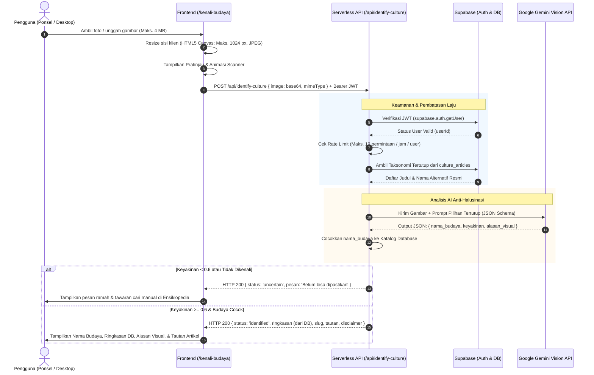

# 🌴 Tour Penjelajah Bali

> **Platform Pemandu Wisata Cerdas Berbasis Gamifikasi untuk Bali Digifest 2026 (AI Web Innovation Challenge)**  
> *Mengangkat Permata Tersembunyi (Hidden Gems) Bali Melalui Rekomendasi Cerdas, Rute Gamifikasi, Edukasi Budaya, dan AI Vision*

[](https://vitejs.dev/)
[](https://tailwindcss.com/)
[](https://supabase.com/)
[](https://ai.google.dev/)
[](https://vercel.com/)
[](scripts/)

---

## 📌 Daftar Isi
1. [Latar Belakang & Masalah](#-latar-belakang--masalah)
2. [Solusi & Nilai Inovasi](#-solusi--nilai-inovasi)
3. [Daftar Fitur Lengkap Aplikasi](#-daftar-fitur-lengkap-aplikasi)
4. [Arsitektur Sistem & Alur AI Vision](#-arsitektur-sistem--alur-ai-vision)
5. [Daftar Environment Variables](#-daftar-environment-variables)
6. [Audit Keamanan & Penegakan Privasi](#-audit-keamanan--penegakan-privasi)
7. [Akun Demo & Skenario Uji End-to-End](#-akun-demo--skenario-uji-end-to-end)
8. [Panduan Instalasi & Menjalankan Lokal](#-panduan-instalasi--menjalankan-lokal)
9. [Panduan Setup Supabase Database](#-panduan-setup-supabase-database)
10. [Panduan Deployment ke Vercel](#-panduan-deployment-ke-vercel)
11. [Technology Disclosure](#-technology-disclosure)
12. [Checklist Akhir Submission](#-checklist-akhir-submission)

---

## 🌾 Latar Belakang & Masalah

Pariwisata Bali menghadapi tantangan besar berupa **over-tourism** yang terpusat di kawasan selatan (Kuta, Seminyak, Canggu, Ubud selatan). Dampak dari fenomena ini meliputi:
- Kemacetan parah dan degradasi kenyamanan wisatawan.
- Ketimpangan ekonomi daerah: destinasi di Bali Utara (Buleleng), Barat (Jembrana), Timur (Karangasem), dan Tengah (Tabanan/Bangli) kerap sepi pengunjung meskipun memiliki nilai sejarah, alam, dan budaya yang luar biasa.
- Komersialisasi berlebih yang mengikis penghayatan otentik terhadap kesakralan adat dan kearifan lokal Bali.

---

## 💡 Solusi & Nilai Inovasi

**Tour Penjelajah Bali** hadir sebagai platform pemandu wisata cerdas yang menggabungkan:
1. **AI Content-Based Filtering (CBF) dengan Novelty Boost:** Algoritma rekomendasi cerdas yang menyeimbangkan kecocokan minat pengguna dengan bobot kebaruan (novelty boost 30%) untuk mempromosikan destinasi otentik non-viral (*hidden gems*).
2. **Jalur Gamifikasi ala Duolingo:** Menyajikan rencana perjalanan 4 destinasi (3 tempat wisata + 1 kuliner tradisional) sebagai rute petualangan interaktif dengan titik-titik setapak bernomor, persentase kecocokan, dan panduan etika budaya lokal (*dharmaning malancaran*).
3. **Kamus Bahasa Bali Gaya KBBI:** Menghormati hierarki bahasa Bali (*Anggah-Ungguhing Basa Bali*) mulai dari Alus Singgih (ASI) hingga Andap/Kasar (AK) untuk interaksi santun wisatawan dengan warga lokal.
4. **Ensiklopedia Budaya Bali Bergaya Majalah:** Edukasi budaya komprehensif, penghormatan kesakralan pura, sistem Subak, kriya tenun, dan kuliner rempah tradisional dengan transparansi sumber.
5. **Fitur 'Kenali Budaya' dari Foto (Gemini Vision AI):** Kamera cerdas pendeteksi busana adat pura, sesaji canang, patung ogoh-ogoh, dan arsitektur Bali dengan **kebijakan ketat anti-halusinasi** berbasis taksonomi tertutup dan penegakan privasi *zero-storage*.

---

## 🚀 Daftar Fitur Lengkap Aplikasi

### 1. Platform Petualangan & Rekomendasi AI (MVP)
- 🍃 **Beranda Dinamis:** Hero interaktif dengan animasi daun jatuh lembut, statistik pemerataan wisata 9 kabupaten, dan panduan 3 langkah mudah berpetualang.
- 🔐 **Autentikasi & Profil Pengguna:** Pendaftaran dan login aman menggunakan Supabase Auth dengan penanganan sesi otomatis dan perlindungan rute.
- 🧭 **Onboarding Preferensi:** Personalisasi minat (alam, budaya, kuliner, sejarah, pantai, desa wisata), pilihan 9 kabupaten/kota Bali (+ opsi "Kejutkan Saya"), dan level anggaran.
- 🗺️ **Rute Jalur Petualangan (Duolingo Style):** Visualisasi progres 0/4 hingga 4/4 dengan kartu detail destinasi, skor kecocokan, alasan rekomendasi, etika berkunjung, dan integrasi budaya.
- ⭐ **Modal Ulasan & Rating:** Formulir bintang 1-5 dan ulasan langsung yang menandai status selesai secara atomik.
- 🎉 **Modal Perayaan Selesai:** Dialog ucapan selamat interaktif saat seluruh 4 tempat selesai dijelajahi.
- 🏅 **Galeri Lencana Pencapaian:**
  - 🏆 **Penjelajah Pemula:** Diberikan saat menyelesaikan paket petualangan pertama (4/4 destinasi).
  - 🏔️ **Penjelajah Utara:** Diberikan jika paket berisi minimal 1 destinasi di Buleleng, Karangasem, atau Jembrana.
  - 🎭 **Pencari Budaya:** Diberikan jika minimal 2 tempat berkategori budaya berhasil diselesaikan.

### 2. Kamus Interaktif Bahasa Bali (Tahap 7)
- 📖 **Kamus Gaya KBBI:** 46 kosakata esensial terkurasi lengkap dengan aksara latin, kelas kata, contoh kalimat nyata, terjemahan Indonesia/Inggris, dan padanan tingkatan.
- 🗣️ **5 Tingkatan Bahasa Bali (*Anggah-Ungguhing Basa Bali*):** Alus Singgih (ASI), Alus Sor (ASO), Alus Madya (AMA), Andap/Kasar (AK), dan Umum/Netral.
- 🔍 **Pencarian Cepat & Toleran Typo:** Didukung ekstensi PostgreSQL `pg_trgm` dan pencarian lokal ber-cache instan.
- ☀️ **Kruna Rahina Mangkin (Kata Hari Ini):** Kartu kosakata harian otomatis di Beranda untuk membiasakan wisatawan berbahasa santun.

### 3. Ensiklopedia Budaya Bali (Tahap 8)
- 🏛️ **Koleksi Artikel Majalah:** 10 topik kebudayaan mendalam (Etika Pura, Canang Sari, Sistem Subak UNESCO, Tari Kecak, Ogoh-ogoh, Kain Tenun Gringsing & Endek, Arsitektur Asta Kosala Kosali, Kuliner Base Genep/Lawar, Upacara Melasti, Tari Pendet).
- 🛡️ **Sanitasi Markdown Aman:** Menghindari celah XSS dengan parser markdown yang aman dan teruji.
- 🔗 **Relasi Destinasi (`place_culture`):** Menampilkan tempat-tempat nyata dalam paket petualangan yang terhubung dengan nilai budaya artikel tersebut.
- 📚 **Transparansi Rujukan:** Seluruh sumber rujukan dicantumkan secara terbuka dengan penanda integritas `[PERLU DIVERIFIKASI]`.

### 4. Kenali Budaya dari Foto (Tahap 9 & 10)
- 📸 **Kamera Ponsel & Unggah Galeri:** Antarmuka responsif dengan tombol kamera langsung (`capture="environment"`) dan pemilih file.
- ⚡ **Resize Sisi Klien (Client-Side Canvas):** Otomatis membatasi ukuran gambar ke sisi terpanjang maksimal 1024 px berformat JPEG untuk hemat kuota internet seluler (batas file 4 MB).
- 🛡️ **Zero-Hallucination Policy:** Model vision AI dibatasi pada taksonomi pilihan tertutup (*closed-set taxonomy*) dari artikel budaya resmi.
- 🎯 **Ambang Batas Keyakinan (Confidence Threshold):** Jika keyakinan model < 60% atau tidak dikenali, sistem menolak menebak (*"Belum bisa dipastikan"*) dan menawarkan pencarian manual di ensiklopedia.
- 📖 **Integritas Fakta Database:** Judul dan ringkasan yang ditampilkan diambil **100% langsung dari database artikel**, bukan dari hasil generasi teks AI bebas.
- 🔒 **Privasi Total (Zero-Storage):** Foto hanya diproses sementara di memori, **tidak pernah disimpan di server maupun database**, dan tidak dicatat dalam log.

---

## 🏗️ Arsitektur Sistem & Alur AI Vision

### 1. Diagram Alur Keseluruhan Aplikasi

```
[User Browser]
      │
      ├─── (1) Auth & Direct Data Queries (via Supabase JS Client + RLS) ──────┐
      │                                                                         ▼
      ├─── (2) POST /api/recommend (Authorization: Bearer <JWT>) ───► [Backend: Vercel Serverless]
      │                                                                         │
      │                                                                         ▼
      │                                                              [AI: Content-Based Filtering]
      │                                                              (TF-IDF + Novelty Boost 30%)
      │                                                                         │
      │                                                                         ▼
      │                                                              [Database: Supabase PostgreSQL]
      │                                                              (Profiles, Places, Trips, Badges)
      │
      └─── (3) POST /api/identify-culture (Image + JWT) ────────────► [Backend: Vercel Serverless]
                                                                                │
                                                                                ▼
                                                                     [Google Gemini Vision API]
                                                                     (Closed Choice Taxonomy)
                                                                                │
                                                                                ▼
                                                                     [Anti-Hallucination Matcher]
                                                                                │
                                                                                ▼
                                                                     [Database: culture_articles]
                                                                     (Ringkasan Resmi + Slug)
```

### 2. Diagram Alur Detail Fitur 'Kenali Budaya' dari Foto



---

## 🔑 Daftar Environment Variables

Untuk menjamin keamanan sistem, variabel lingkungan dibagi secara ketat antara **Publik** (dibundel ke browser dengan prefix `VITE_`) dan **Rahasia** (hanya berada di runtime serverless backend):

| Nama Variabel | Sifat | Lokasi Penggunaan | Deskripsi & Contoh Nilai |
|---|---|---|---|
| `VITE_SUPABASE_URL` | **PUBLIK** | Frontend (`src/lib/supabaseClient.js`) & Serverless | URL project Supabase (`https://xyz.supabase.co`). Aman di browser karena dilindungi RLS. |
| `VITE_SUPABASE_ANON_KEY` | **PUBLIK** | Frontend (`src/lib/supabaseClient.js`) & Local Proxy | Kunci publik Supabase (`anon-key`). Operasi dibatasi oleh Row Level Security. |
| `SUPABASE_SERVICE_ROLE_KEY` | **RAHASIA** | Backend / Vercel Serverless (`/api/*`) | Kunci rahasia bypass RLS untuk administrasi backend. **Dilarang keras ada di frontend atau Git.** |
| `SUPABASE_URL` | **RAHASIA / OPSIONAL** | Backend / Vercel Serverless (`/api/*`) | Endpoint Supabase untuk lingkungan serverless (bila tidak membaca `VITE_SUPABASE_URL`). |
| `GEMINI_API_KEY` | **RAHASIA** | Backend / Vercel Serverless (`/api/identify-culture.js`) | Kunci API Google AI Studio untuk pemrosesan Gemini Vision. |
| `GEMINI_MODEL` | **RAHASIA / OPSIONAL** | Backend / Vercel Serverless (`/api/identify-culture.js`) | Nama model Gemini Vision yang digunakan (default: `gemini-2.5-flash` atau `gemini-1.5-flash`). |

Template variabel lingkungan tersedia tanpa nilai asli di [.env.example](.env.example).

---

## 🛡️ Audit Keamanan & Penegakan Privasi

1. **Pencegahan Kebocoran Secret:**
   - Seluruh secret (`SUPABASE_SERVICE_ROLE_KEY`, `GEMINI_API_KEY`) hanya dipanggil di lingkungan serverless Node.js melalui `process.env`.
   - File `.env`, `.env.local`, dan file credential lainnya diabaikan secara ketat oleh [.gitignore](.gitignore).
   - Riwayat git dan codebase bersih dari API key asli atau token JWT statis.
2. **Row Level Security (RLS) Menyeluruh:**
   - Tabel `profiles`: Hanya pemilik yang dapat membaca dan memperbarui profil mereka (`auth.uid() = id`).
   - Tabel `places`, `badges`, `dictionary`, `culture_articles`: Terbuka baca publik (`SELECT`), seluruh mutasi tulis (`INSERT/UPDATE/DELETE`) dibatasi hanya untuk `service_role`.
   - Tabel `trips`, `trip_items`, `reviews`, `user_badges`: Hanya pengguna pemilik yang dapat mengakses atau mengubah item mereka.
3. **Validasi Input & Pencegahan Injeksi:**
   - Seluruh endpoint `/api` memvalidasi metode HTTP, header `Authorization: Bearer <token>`, tipe MIME, dan ukuran payload.
   - Luaran Markdown pada artikel ensiklopedia disanitasi secara ketat sebelum dirender ke DOM untuk mencegah XSS.
4. **Pembatasan Laju (Rate Limiting):**
   - `/api/identify-culture`: Maksimal 10 permintaan per jam per pengguna (menghindari spam kuota AI Vision).
   - `/api/recommend`: Maksimal 30 permintaan per jam per pengguna.
   - Header `X-RateLimit-Limit`, `X-RateLimit-Remaining`, dan `Retry-After` disertakan otomatis saat kuota terlampaui.
5. **CORS & Header Keamanan:**
   - `X-Content-Type-Options: nosniff`
   - `X-Frame-Options: DENY`
   - `X-XSS-Protection: 1; mode=block`
   - `Referrer-Policy: strict-origin-when-cross-origin`
   - `Permissions-Policy: camera=(self), microphone=(), geolocation=(self)`
6. **Kebijakan Privasi Foto (*Zero-Storage*):**
   - Foto dari kamera ponsel/galeri tidak disimpan di storage server maupun database.
   - Data gambar base64 tidak pernah dicatat di log sistem.
   - Pemrosesan gambar hanya terjadi sementara (*in-memory*) selama komunikasi dengan Gemini API.

---

## 🧪 Akun Demo & Skenario Uji End-to-End

Untuk memudahkan penguji atau juri **Bali Digifest 2026** menguji seluruh fitur dari awal hingga akhir, gunakan data contoh non-pribadi berikut:

### Kredensial Akun Demo
- **Email:** `demo.penjelajah@balidigifest.id`
- **Kata Sandi:** `PenjelajahBali2026!`
- **Nama Lengkap:** `Wayan Penjelajah Cerdas`

---

### Skenario Uji Langkah Demi Langkah

#### Skenario 1: Petualangan & Gamifikasi (MVP)
1. **Masuk Akun:** Buka `/src/pages/masuk.html` dan login menggunakan kredensial demo di atas.
2. **Onboarding Preferensi:** Pilih minat *Alam* dan *Budaya*, pilih wilayah *Buleleng* dan *Tabanan*, lalu simpan.
3. **Generate Petualangan:** Di `/src/pages/petualangan.html`, klik **Buat Petualangan Baru**. AI Recommender Engine akan meracik 4 tempat unik (3 wisata + 1 kuliner non-viral).
4. **Selesaikan Checkpoint:** Tandai "Selesai Jelajah" pada tiap titik, beri rating dan ulasan singkat.
5. **Raih Lencana:** Selesaikan seluruh 4 titik rute. Dialog perayaan akan muncul dan membuka lencana *Penjelajah Pemula*, *Penjelajah Utara*, dan *Pencari Budaya* di `/src/pages/lencana.html`.

#### Skenario 2: Kamus Bahasa Bali & Edukasi
1. Buka menu **Kamus** di `/src/pages/kamus.html`.
2. Ketik kata *"suksma"* atau *"pura"* pada kotak pencarian.
3. Klik kartu kata untuk melihat aksara latin, tingkatan bahasa (*Alus Madya / Alus Singgih*), contoh kalimat percakapan, dan catatan etika berbicara.
4. Kembali ke Beranda `/` untuk melihat fitur *Kruna Rahina Mangkin* (Kata Hari Ini).

#### Skenario 3: Ensiklopedia Budaya
1. Buka menu **Budaya** di `/src/pages/budaya.html`.
2. Pilih filter kategori (misal: *Upacara & Ritual* atau *Etika & Tata Krama*).
3. Klik artikel *"Canang Sari: Makna Filosofis di Balik Persembahan Bunga Harian"*.
4. Pelajari etika wisatawan terhadap canang, daftar rujukan sumber, dan destinasi petualangan terkait.

#### Skenario 4: Fitur 'Kenali Budaya' dari Foto
1. Buka menu **Kenali Budaya** di `/src/pages/kenali-budaya.html`.
2. Perhatikan banner jaminan privasi (*foto tidak disimpan*).
3. Klik **Pilih dari Galeri** atau **Ambil Foto (Kamera)** di ponsel.
4. Unggah foto objek budaya Bali (misal foto canang sari, pura, atau tari kecak).
5. Sistem di browser akan me-resize gambar ke sisi terpanjang 1024 px (JPEG).
6. Klik **Kenali Budaya Sekarang**. Amati animasi *scanner* dan status analisis.
7. Sistem menyajikan nama budaya, ringkasan resmi dari database, persentase keyakinan, alasan visual, tautan artikel lengkap, dan disclaimer AI.
8. Uji coba foto di luar budaya Bali (misal foto kendaraan atau pemandangan acak) untuk menyaksikan penolakan anti-halusinasi (*"Belum bisa dipastikan"* dan tawaran pencarian manual).

---

## 💻 Panduan Instalasi & Menjalankan Lokal

### Prasyarat
- [Node.js](https://nodejs.org/) v18.0.0 atau lebih baru (direkomendasikan v20+ atau v24).
- Akun [Supabase](https://supabase.com/) aktif.
- Kunci API Google AI Studio ([Gemini API Key](https://aistudio.google.com/)).

### 1. Kloning Repositori
```bash
git clone https://github.com/username/tour-penjelajah-bali.git
cd tobal
```

### 2. Instal Dependensi
```bash
npm install
```

### 3. Konfigurasi Environment Variables
Salin template `.env.example` ke `.env`:
```bash
cp .env.example .env
```
Buka file `.env` dan isi variabel yang diperlukan:
```ini
VITE_SUPABASE_URL=https://your-project.supabase.co
VITE_SUPABASE_ANON_KEY=your-supabase-anon-key
SUPABASE_SERVICE_ROLE_KEY=your-supabase-service-role-key
GEMINI_API_KEY=your-gemini-api-key
GEMINI_MODEL=gemini-2.5-flash
```

### 4. Menjalankan Rangkaian Pengujian Otomatis
Jalankan seluruh uji unit algoritma rekomendasi dan uji integrasi AI Kenali Budaya (51 tes):
```bash
npm test
```
*Hasil yang diharapkan: 51 / 51 pengujian BERHASIL (100% PASS).*

Untuk menguji fitur Kenali Budaya saja:
```bash
npm run test:identify
```

### 5. Menjalankan Server Pengembangan (Dev Server)
```bash
npm run dev
```
Buka peramban di `http://localhost:3000`.

### 6. Membangun Bundle Produksi
```bash
npm run build
```
Hasil build multi-page yang dioptimalkan akan tersimpan di direktori `dist/`.

---

## 🗄️ Panduan Setup Supabase Database

Eksekusi skrip SQL di menu **SQL Editor** pada Dashboard Supabase Anda secara berurutan:

```
[1. schema.sql] ──► [2. seed.sql] ──► [3. functions.sql] ──► [4. 002_dictionary.sql] ──► [5. 003_culture.sql]
```

1. **`supabase/schema.sql`**: Membuat 7 tabel utama (`profiles`, `places`, `trips`, `trip_items`, `reviews`, `badges`, `user_badges`), trigger pembuatan profil otomatis, dan konfigurasi RLS.
2. **`supabase/seed.sql`**: Memasukkan 26 destinasi Bali di 9 kabupaten/kota dan 3 lencana pencapaian awal.
3. **`supabase/functions.sql`**: Membuat fungsi PostgreSQL `complete_trip_item` berbasis `SECURITY DEFINER` untuk transaksi atomik ulasan dan evaluasi lencana.
4. **`supabase/migrations/002_dictionary.sql`**: Mengaktifkan ekstensi `pg_trgm`, tabel `dictionary`, index GIN trigram, dan 46 kosakata Bali terkurasi.
5. **`supabase/migrations/003_culture.sql`**: Membuat tabel `culture_articles`, tabel relasi `place_culture`, dan 10 artikel pengantar kebudayaan mendalam.

---

## ☁️ Panduan Deployment ke Vercel

Aplikasi ini telah siap dideploy ke [Vercel](https://vercel.com/) dengan konfigurasi bawaan di [vercel.json](vercel.json).

### 1. Push Kode ke Repositori GitHub
```bash
git add .
git commit -m "feat: Tahap 10 - Finalisasi & rilis produksi Tour Penjelajah Bali"
git push origin main
```

### 2. Hubungkan ke Vercel Dashboard
1. Buka [Vercel Dashboard](https://vercel.com/dashboard) -> klik **Add New...** -> **Project**.
2. Pilih repositori GitHub Anda.
3. Pengaturan build akan otomatis terdeteksi dari `vercel.json` (`Vite`, `npm run build`, `dist`).

### 3. Masukkan Environment Variables di Vercel
Pada bagian **Settings -> Environment Variables**, tambahkan:
- `VITE_SUPABASE_URL`
- `VITE_SUPABASE_ANON_KEY`
- `SUPABASE_SERVICE_ROLE_KEY`
- `GEMINI_API_KEY`
- `GEMINI_MODEL` (diisi `gemini-2.5-flash`)

### 4. Deploy & Validasi
Klik tombol **Deploy**. Setelah deployment selesai, uji seluruh alur di domain produksi Vercel.

---

## 📋 Technology Disclosure

Sesuai transparansi inovasi digital dan standar kompetisi **Bali Digifest 2026**:

1. **Frontend Core:**
   - Arsitektur: Multi-Page Application (MPA) berbasis **HTML5 & Vanilla JavaScript (ES Modules)** untuk kecepatan muat tinggi dan kejelasan struktur kode.
   - Styling: **Tailwind CSS v3.4** dengan palet warna natural terkurasi (*daun, lumut, krem, pasir, tanah, padi*).
   - Bundler & Tooling: **Vite v8.3** dengan plugin dev server serverless proxy.
2. **Database & Backend:**
   - Database: **Supabase PostgreSQL** dengan pengamanan ketat **Row Level Security (RLS)** di seluruh tabel.
   - Ekstensi: `pg_trgm` (PostgreSQL Trigram Search Extension) untuk pencarian teks fleksibel.
   - Serverless Functions: **Vercel Serverless (Node.js)** untuk endpoint `/api/recommend` dan `/api/identify-culture`.
3. **Metode Kecerdasan Buatan (AI):**
   - **Content-Based Filtering (CBF):** Ekstraksi fitur token TF-IDF pada tags destinasi + One-Hot Encoding pada wilayah & kategori + *Cosine Similarity* (bobot 0.7) + Formula *Novelty Boost* `(1 - Popularitas/100) * 0.3` untuk mengangkat destinasi otentik non-viral (*hidden gems*).
   - **Vision AI:** **Google Gemini API Vision** (`gemini-2.5-flash` / `gemini-1.5-flash`) dengan batasan taksonomi tertutup (*closed-set prompt*), luaran JSON ketat, ambang batas keyakinan 60%, dan pencocokan ringkasan faktual langsung dari database artikel.
4. **Library & Ketergantungan:**
   - `@supabase/supabase-js` v2.49.0 (Koneksi Supabase Auth & PostgreSQL)
   - `lucide` v0.500.0 (Koleksi ikon open-source modern)
   - `postcss` v8.4 & `autoprefixer` v10.4
5. **Integritas Dataset:**
   - Data katalog 26 destinasi wisata dan kuliner Bali.
   - Data 46 kosakata Kamus Bahasa Bali dengan tingkatan bahasa.
   - Data 10 artikel Ensiklopedia Budaya Bali.
   - **Pernyataan Verifikasi:** Seluruh data *seed* awal diberi penanda `[PERLU DIVERIFIKASI]`. Data ini disusun sebagai purwarupa edukasi dan dirancang untuk diverifikasi secara berkala bersama penutur asli bahasa Bali, komunitas adat banjar, dan instansi dinas kebudayaan terkait.
6. **Hosting & Infrastruktur:**
   - Frontend & Serverless: Vercel Cloud Platform.
   - Database Cloud: Supabase Managed Cloud.
7. **AI Coding Assistant:**
   - Dikembangkan secara berpasangan (*pair programming*) menggunakan **Google Antigravity** (Advanced Agentic AI Coding Assistant by Google DeepMind).
8. **Aset Pihak Ketiga & Lisensi:**
   - Tipografi: *Fraunces* (Google Fonts, SIL Open Font License 1.1) & *Nunito Sans* (Google Fonts, SIL Open Font License 1.1).
   - Ikon: *Lucide Icons* (ISC License).
   - Foto Destinasi & Budaya: *Unsplash License* (Bebas digunakan untuk keperluan non-komersial dan demonstrasi kompetisi).

---

## ✅ Checklist Akhir Submission

Berikut rangkuman data untuk pengisian formulir submisi **Bali Digifest 2026**:

| Item Submisi | Keterangan / Nilai |
|---|---|
| **Nama Proyek** | Tour Penjelajah Bali |
| **Kategori Lomba** | AI Web Innovation Challenge — Bali Digifest 2026 |
| **URL Deployment Produksi** | `https://tour-penjelajah-bali.vercel.app` *(atau domain Vercel Anda)* |
| **Link Repositori GitHub** | `https://github.com/username/tour-penjelajah-bali` |
| **Release Tag / Commit** | `v1.0.0-final` / Commit Final Tahap 10 |
| **Akun Demo Pengujian** | Email: `demo.penjelajah@balidigifest.id` \| Password: `PenjelajahBali2026!` |
| **Status Unit Test** | **51 / 51 Lolos (100% Passing)** via `npm test` |
| **Dokumentasi Lengkap** | [README.md](README.md) |

---

## 📄 Lisensi & Hak Cipta
Hak Cipta © 2026 **Tour Penjelajah Bali**. Dibuat untuk **Bali Digifest 2026**.
